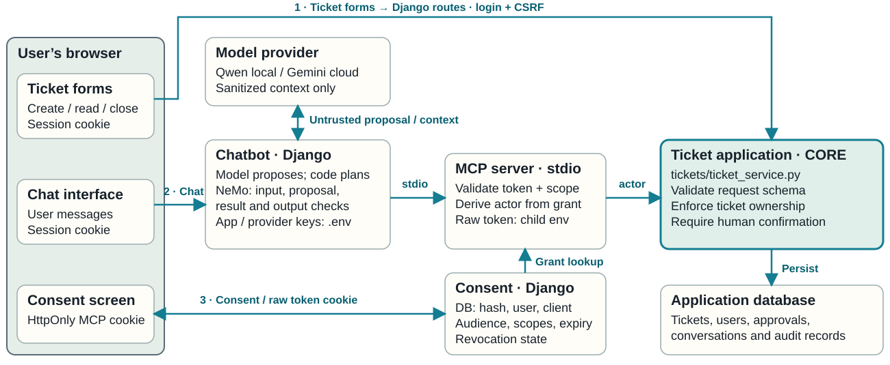

# Workshop 2 — Secure Application Design and Code Defense

## Offline slides

[Open the Session 2 slides](session2_workshop_deck.html). Download or copy this
single HTML file and open it directly in Chrome. Its slides, diagrams,
definitions and interactive illustrations work offline; no server or additional
files are needed to present them. Live application demonstrations still use the
workshop application.

Use the arrows or keyboard arrow keys to navigate, the index to jump to a topic,
and Read view to review all slides. The lock and purple gem icons show definitions
for the current slide. The presentation follows nine workshop exercises.

## System architecture and trust boundaries



This map shows the **repaired design in `solution/`**. The starter deliberately
omits some enforcement for the exercises. The dashed boundary groups local
processes on the workshop host; it does not make MCP or NeMo an OS security sandbox.

1. **Browser and consent:** Django authenticates the website session and checks CSRF on writes. The user grants specific assistant scopes for a limited time. This is simplified OAuth-style delegated authorization, not a full OAuth authorization-code / PKCE implementation.
2. **Chatbot and model:** the agent sends sanitized context to Qwen or Gemini. Model output is an untrusted proposal. The model receives no MCP token and cannot establish the actor or grant itself permissions.
3. **Guardrails:** the private NeMo worker checks input, tool proposals, tool results and final output. Schema validation and bounded agent execution apply alongside those checks. A guardrail allow decision does not authorize ticket access.
4. **MCP:** the client starts a local stdio server and passes the token through its process environment. The server hashes it and looks up the grant, checking client, audience, expiry, revocation, active user and operation scope. It derives the actor from that grant.
5. **Core ticket application:** `tickets/ticket_service.py` checks schema and record ownership, assigns new tickets to the actor and requires human confirmation for closure. Ordinary ticket pages call this same service with the session user; they do not require assistant consent or MCP.

### Where permissions and secrets live

| Item | Location and use |
| --- | --- |
| Assistant grant and permissions | Database `MCPAccessGrant`: token hash, user, client ID, audience, scopes, expiry and revocation. `security/mcp_authorization.py` maps tools to scopes and validates grants. |
| Record permissions and closure approval | `tickets/ticket_service.py` enforces ownership and confirmation using database ticket/approval records. A read scope never grants access to another user's tickets. |
| Raw MCP token | Browser HttpOnly, SameSite=Lax cookie scoped to `/chatbot/` (Secure when served over HTTPS), Django request context, then child-process `MCP_ACCESS_TOKEN`. The consent page shows it once for the terminal exercise. The grant table stores its SHA-256 hash, not the raw value. |
| Django secret | Local ignored `.env` / process environment (`DJANGO_SECRET_KEY`), loaded into Django settings and explicitly passed to the MCP child. |
| Optional Gemini API key | Local ignored `.env` / web-process settings (`GEMINI_API_KEY`); used to authenticate provider requests. It is not forwarded to the MCP or NeMo child and is not prompt content. |
| NeMo worker configuration | Local `guardrails/` policy/configuration files and Qwen endpoint/model settings. The worker does not receive the MCP token or Gemini key. |
| User records | Database: password hashes, sessions, tickets, conversations, approvals and audit records. These are data to protect, not model authorization instructions. |

The browser, prompt text and model proposals are untrusted inputs. The server
trusts validated session/grant records to identify the actor and enforces
permissions in code. MCP and NeMo run under the local host account; process
separation alone does not protect the database or `.env` from a compromised host.

## Start the application after initial setup

Open port **8000** in the Codespaces **Ports** panel, then visit `/tickets/`. Keep this terminal running;
Ctrl+C stops the website. Assistant actions start the MCP server automatically. Ordinary ticket pages use the shared ticket service directly.

**Codespaces:** from the repository root:

```bash
cd starter
source .venv/bin/activate
python manage.py runserver 0.0.0.0:8000
```

Open port **8000** in the **Ports** panel, then visit `/tickets/`.

First time running the project? Complete [Codespaces setup](docs/GITHUB_CODESPACES_SETUP.md) first.


This workshop uses a configurable support ticket system with an optional AI assistant.
Students can create and manage tickets through ordinary forms or ask the assistant
for help. They find security flaws, repair the Python code and test the results.

The project builds on the protected chatbot from Session 1. The new challenge is
that the assistant can request changes to saved records, so the application must
check permissions before carrying out those requests. All accounts and ticket
contents used in the exercises are made up.

## Where the code lives

Each application folder has this structure:

```text
manage.py                 Start Django and run management commands
support_portal/
  settings.py             One INSTALLED_APPS list and project settings
  urls.py                 Main URL dispatcher
tickets/
  urls.py                 /tickets/ routes
  views.py                Ticket pages and form submissions
  models.py               Tickets, approvals and audit records
  ticket_service.py       Shared ticket operations and permissions
  schema.py               Allowed ticket request fields and types
  templates/tickets/      Ticket pages and the shared page layout
chatbot/
  urls.py                 Assistant and consent routes
  views.py                Assistant HTTP requests and conversation
  authorization_views.py  Consent, token delivery and revocation
  models.py               Chat messages and MCP access grants
  planner.py              Model prompt and structured model output
  agent.py                Model/tool conversation loop
  mcp_client.py           Assistant connection to MCP
  tool_policy.py          Assistant tool checks and NeMo integration
  templates/chatbot/      Assistant and consent pages
  static/chatbot/chat.js  Asynchronous chat and Debug controls
mcp_server/server.py      MCP tools calling the shared ticket service
guardrails/               NeMo rules and worker
security/                 Token validation, redaction and diagnostics
tests/                    Automated workshop tests
```

`support_portal` is the Django project for the configurable support portal. `tickets` and `chatbot` are the two Django
applications. Their registrations appear together in `support_portal/settings.py`;
there is no second `INSTALLED_APPS` assignment elsewhere.

The main dispatcher routes `/tickets/` to `tickets/urls.py` and `/chatbot/` to
`chatbot/urls.py`. Starting Django starts one website containing both applications.

### Updating an existing workshop copy

Stop the website with Ctrl+C. In the same activated environment, run:

```bash
python manage.py migrate
python manage.py runserver 0.0.0.0:8000
```

The initial `tickets` migration creates tables for a new installation or renames
the previous ticket tables while retaining their records, IDs and permissions.
The new chatbot migration adds authorization records without resetting accounts
or tickets. Users grant assistant access through the browser.
The former folder names are not kept
as import aliases. Codespaces uses `0.0.0.0:8000` when starting the website.

## How the ticket system and assistant connect

The ticket application is the core: `tickets/ticket_service.py` owns validation,
record ownership and human confirmation. The browser's ticket forms call Django
routes that use this service directly. The chatbot is an optional second entry
point: its code checks model proposals with NeMo and calls MCP, which validates
the delegated grant before passing the authenticated actor to the same service.

The [system map above](#system-architecture-and-trust-boundaries) shows these
separate paths and the locations of consent, credentials and stored records.

Ordinary ticket pages work without MCP, delegated access tokens, NeMo or a model.
The assistant uses MCP to reach the same ticket service. Both paths enforce the
same ticket permissions. See [the architecture and trust boundaries](docs/THREAT_MODEL.md).

## Before you begin

You should be comfortable with:

- Basic Python: functions, dictionaries, imports and exceptions. You will read
  tests and edit the code that checks ticket requests.
- Using a terminal, opening files in an editor and activating an existing Python
  environment. The setup guides provide the commands.
- Basic web concepts: a browser sends a request to a server; a session keeps a
  user signed in; JSON represents named fields and values.
- The Session 1 idea of **prompt injection**: a message tries to make an AI ignore
  its instructions or reveal information. This workshop carries those protections
  into an application that can also read and change data.

You do not need previous experience with MCP, NeMo, Colang, Bandit or Semgrep.
The exercises explain them where they are used.

## Topics covered

1. Use the ticket system and its optional assistant, then check that normal ticket
   creation and reading work.
2. Inspect the prompt and JSON returned by Qwen, and follow the requested action
   through to the ticket returned by the server.
3. Reject invalid ticket requests, including unexpected fields and incorrect types.
4. Prevent one student from reading or closing another student's tickets.
5. Start the MCP ticket server, discover its actions, and check which requests
   it permits when called directly.
6. Require confirmation before closing a ticket, and reject expired or reused
   confirmations.
7. Authorize the assistant on behalf of a user, choose delegated permissions,
   and demonstrate token expiry, replacement and revocation.
8. Run the NeMo process directly, send JSON requests through standard input and
   inspect its allow/block decisions.
9. Configure NeMo by editing a Python rule, defining its Colang flow and enabling
   it in YAML. Test both prohibited and harmless requests.


Follow the [exercise guide](docs/EXERCISES.md) for the steps and expected results.
The application supplied to students deliberately has missing checks. The completed
answer key shows the intended repairs.

## Technologies and where they are used

| Technology | Use in this project |
|---|---|
| **Python and Django** | Run the website, handle sign-in and forms, check permissions, and run tests. See [application views](starter/tickets/views.py) and [tests](starter/tests/). The supported Python versions are 3.12 and 3.13. |
| **SQLite** | Stores students' accounts, tickets, confirmation requests, sessions and action history records. See [ticket models](starter/tickets/models.py). |
| **HTML, CSS and JavaScript** | Provide the ticket pages and assistant interface. JavaScript sends chat requests without reloading the page and shows when the assistant is answering. See [page templates](starter/tickets/templates/tickets/) and [chat code](starter/chatbot/static/chatbot/chat.js). |
| **Qwen and Ollama** | Qwen is the local AI model; Ollama runs it. The assistant requests structured answers from Qwen, and NeMo's model-based checks also use it. See [planner.py](starter/chatbot/planner.py) and [policy.py](starter/guardrails/policy.py). Demo mode needs no model. |
| **Google Gemini, optional** | An alternative model for planning assistant actions, through the Google Gen AI SDK. It needs an API key and an available model. NeMo's model-based checks still use local Qwen. See [planner.py](starter/chatbot/planner.py). |
| **Model Context Protocol (MCP) and its Python SDK** | Connect the optional assistant to the MCP server, discover its actions and request them. Ordinary ticket pages call the shared ticket service directly. This lab uses a private local process connection, not a public HTTP service. See [MCP client](starter/chatbot/mcp_client.py) and [ticket server](starter/mcp_server/server.py). |
| **NVIDIA NeMo Guardrails, Colang and YAML** | Run content checks, inspect the process in Exercise 8 and configure the new rule in Exercise 9. Colang defines the steps of a check; YAML selects which checks run. See [NeMo files](starter/guardrails/). |
| **JSON Schema and Pydantic** | Define allowed request fields and value types. JSON Schema checks application requests; Pydantic enforces typed MCP parameters. See [schema.py](starter/tickets/schema.py) and [server.py](starter/mcp_server/server.py). |
| **python-dotenv and Django authorization records** | Load application configuration; store delegated permissions, token hashes, expiry and revocation in SQLite. The browser receives the client token after consent. See [authorization](starter/security/mcp_authorization.py). |
| **Django's test runner and unittest** | Check normal use, refused requests, confirmations, agent behavior and actual NeMo configuration. All automated test modules are in [tests/](starter/tests/). |
| **Bandit and Semgrep** | Inspect source code for unsafe patterns. See [scanner script](starter/scripts/run_sast.py), [Semgrep rules](starter/scripts/semgrep.yml). |
| **GitHub Actions and Codespaces** | Actions runs tests and scans when changes are pushed. Codespaces provides the configured development environment, including Ollama. See [workflow](.github/workflows/security.yml) and [container configuration](.devcontainer/devcontainer.json). |

## AI concepts taught and where they appear

| Concept | Meaning and use in the workshop |
|---|---|
| **Large language models (LLMs) and inference** | An LLM generates text from the instructions and information it receives. Inference means running an existing model to produce an answer or proposed action. The workshop uses Qwen or optional Gemini; it does not train or fine-tune models. See [planner.py](starter/chatbot/planner.py). |
| **Prompts and conversation context** | A prompt is the text sent to the model. Here it includes instructions, recent messages and returned ticket data. Students inspect what was sent using **Debug → Show full prompt**. See [planner.py](starter/chatbot/planner.py) and [agent.py](starter/chatbot/agent.py). |
| **Structured output** | The model must return an action with defined fields, or a reply, rather than arbitrary instructions for Python to execute. [Exercise 2](docs/EXERCISES.md#2-inspect-the-models-json-output) inspects the prompt and actual model output. Exercise 3 adds checks that reject invalid action data. See [schema.py](starter/tickets/schema.py). |
| **Tool use** | A tool is an action the assistant can request, such as reading a ticket. The model selects an action; application code checks it and asks the ticket server to perform it. See [MCP client](starter/chatbot/mcp_client.py). |
| **An agent's sequence of actions** | The assistant can list tickets, read one and use the result in its next step. Its code limits the number of steps, tool calls and write requests. See [agent.py](starter/chatbot/agent.py) and [agent tests](starter/tests/test_runtime.py). |
| **Prompt injection and untrusted content** | Messages and returned text may try to change the assistant's instructions. The inherited message checks and NeMo reject known prohibited requests; Python still checks ticket permissions independently. See [message checks](starter/chatbot/prompt_security.py) and [NeMo policy](starter/guardrails/policy.py). |
| **Guardrails and model-based decisions** | A guardrail checks whether content should be allowed. Exercise 9 configures an explicit phrase rule and compares it with normal requests. Qwen mode also uses a model to judge content. Students record harmless requests that were blocked (false positives) and prohibited requests that were allowed (false negatives). See [NeMo exercise](docs/EXERCISES.md#9-configure-a-new-nemo-rule) and [tests](starter/tests/test_nemo.py). |
| **Model replies versus saved results** | A model can describe an operation incorrectly. Python therefore builds the displayed ticket result from the server's returned data; model drafts remain available in Debug. See [presentation.py](starter/tickets/presentation.py) and [result tests](starter/tests/test_verified_outcomes.py). |

The workshop uses existing models to generate responses and proposed actions.
It does not train or fine-tune a model.

## Cybersecurity concepts taught and where they appear

| Concept | Meaning and use in the workshop |
|---|---|
| **Authentication and authorization** | Authentication identifies the signed-in student; authorization decides which tickets that student may use. Exercise 4 adds ticket-owner checks. See [ticket policy](starter/tickets/ticket_service.py) and [access tests](starter/tests/test_ticket_access.py). |
| **Input validation** | Check the action name, permitted fields and types before using a request. Exercise 3 adds these checks in both the website and ticket program. See [website checks](starter/chatbot/tool_policy.py), [schema](starter/tickets/schema.py) and [validation tests](starter/tests/test_validation.py). |
| **Least privilege** | Users grant only the operations the assistant needs. A read-only token cannot create tickets; MCP cannot confirm closure. Exercises 5–7 use [delegated permissions](starter/security/mcp_authorization.py) and independent [MCP checks](starter/mcp_server/server.py). |
| **Trust boundaries** | A trust boundary separates components with different permissions. Model output must not be treated as permission to act, and a caller may bypass the website to contact the ticket server directly. The server validates the delegated token, its user, client, audience, permissions, expiry and revocation, then checks ticket ownership. See [server.py](starter/mcp_server/server.py) and [connection checks](starter/scripts/healthcheck.py). |
| **Human confirmation and repeated requests** | Closing a ticket requires a confirmation tied to that student and ticket. It expires after five minutes and works once. A database transaction and conditional update prevent reusing it. Exercise 6 repairs this in [ticket_service.py](starter/tickets/ticket_service.py); [approval tests](starter/tests/test_approval.py) check it. |
| **Access credentials and lifecycle** | Keep model API keys in configuration and delegated tokens out of prompts and logs. User tokens are random, time-limited and revocable; only their hashes are stored in access-grant records. Exercise 7 demonstrates the [consent flow](docs/MCP_AUTHORIZATION.md) and [redaction](starter/security/redaction.py). |
| **CSRF and safe display of text** | CSRF protection prevents another website from submitting a form using a student's session. Django templates and JavaScript also display untrusted text without treating it as executable HTML. See [web tests](starter/tests/test_web_security.py), [templates](starter/tickets/templates/tickets/) and [chat.js](starter/chatbot/static/chatbot/chat.js). |
| **OWASP and CWE** | CWE names a specific weakness; OWASP groups broader application-security risks. Students use them to explain findings and repairs in their reports. See [worked findings](docs/SECURITY_FINDINGS.md) and [evidence template](docs/NOTES_TEMPLATE.md). |
| **Automated tests, SAST and continuous integration** | Tests check behavior. Static Application Security Testing (SAST) inspects source code. Continuous integration runs these checks automatically after code changes. Students use [tests](starter/tests/), [scanner checks](starter/scripts/verify_sast.py) and the [GitHub workflow](.github/workflows/security.yml). Neither passing tests nor a clean scan establishes security beyond the cases actually checked. |

## Get started

Complete [Codespaces setup](docs/GITHUB_CODESPACES_SETUP.md),
then follow [Exercises](docs/EXERCISES.md). Codespaces installs the dependencies,
starts Ollama and downloads the configured Qwen model.

Open port **8000** in the Codespaces **Ports** panel, then visit `/tickets/` to create and manage requests. **Assistant** in the navigation opens the optional chat.

## Start the MCP ticket server yourself

After setup, you can start the ticket server directly. From the repository root,
run these commands in the Codespaces Bash terminal:

```bash
cd starter
source .venv/bin/activate
python mcp_server/server.py
```

It stays running and waits for MCP messages. It has no browser page or HTTP port:
the client communicates through the process's standard input/output. Stop it
with **Ctrl+C**. A manually started process cannot access tickets until you
supply a user token from the consent page.

The website normally starts the server automatically with the consenting user's token.
The [MCP exercise](docs/EXERCISES.md#5-start-the-ticket-mcp-server-and-call-it-directly)
shows manual startup, action discovery, an authenticated ticket read and requests
the server must refuse. Its client starts its own server process rather than
connecting to a manually opened terminal.

## Project files

- `starter/`: the application students run and repair, including its dependencies,
  tests and NeMo files.
- `solution/`: the completed answer key. Students do not need to run a second website.
- `docs/`: setup, exercises, instructor guidance and report templates.
- `.devcontainer/`: Codespaces setup.
- `.github/workflows/`: automated GitHub checks.

Each application folder has one `requirements.txt` for its dependencies and one
`tests/` folder for its tests. Use the existing Python environment for all exercises.
Keep `.env`, `.venv/` and database files out of Git and submissions.

### Activate the environment in every exercise terminal

From `starter`, run `source .venv/bin/activate` in the Codespaces terminal. Then use `python ...` for
all workshop commands. Repeat activation in every new terminal.
See [exercise terminal instructions](docs/EXERCISES.md#every-new-terminal-needs-the-workshop-environment).

## Change the support scenario

See [theme configuration](docs/THEMES.md). The selected theme drives the portal, assistant UI, planner context and demo vocabulary.
