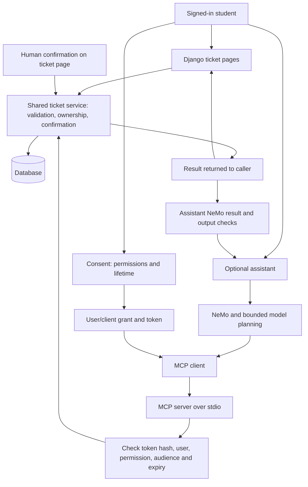
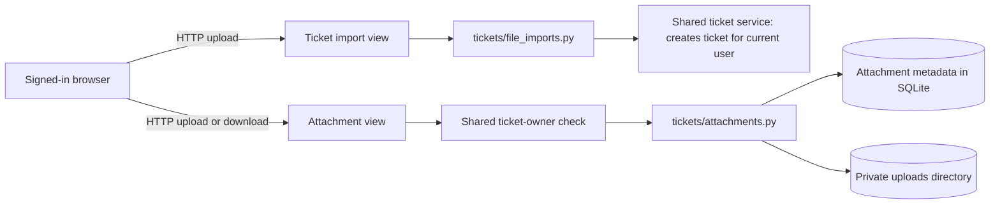

# Session 2 trust boundaries

The application is a ticket system. The assistant is one optional way to request
ticket operations; it is not the parent of the ticket pages or their URLs.

## Pages and operations

- `/tickets/` is the landing page and lists only the signed-in student's tickets.
- `/tickets/new/` creates a request through an ordinary form.
- `/tickets/<id>/` displays a ticket and handles closure, confirmation and cancellation.
- `/chatbot/` is the optional assistant. Its conversation links open ticket detail
  pages in new tabs; the ticket pages are not nested beneath this route.

Ordinary ticket pages call the shared ticket service inside Django. They do not
start MCP processes, read assistant tokens, run NeMo or invoke a model.
The optional assistant uses MCP; its server calls the same shared ticket service.
Student login, CSRF checks and escaped HTML protect the web entry point. User consent and a delegated token protect the assistant entry point. The
server independently checks permission, expiry and revocation on every tool call.
Ownership and confirmation rules are shared, rather than duplicated in adapters.

## Security decisions

Model messages, action proposals and returned data are untrusted. The model cannot
supply authenticated identity or human approval through text. Server policy checks
permissions independently of the website. The assistant has no arbitrary shell or
file tools. Access tokens stay out of model context and are redacted from
traces. The agent has bounded steps, calls and writes. A NeMo outage denies further
assistant tool actions. Ordinary ticket operations continue without NeMo, MCP,
assistant tokens or Qwen.

Verified ticket outcomes are formatted from authorized server results by Python.
A model's final draft cannot replace a successful outcome with a failure claim.
Application exceptions are labeled separately. The application intentionally lacks
schema/ownership/approval controls identified in the exercises; the shared
infrastructure must not be mistaken for completed server authorization.

## Uploaded files are a separate input boundary

The ticket-import view reads an uploaded file through `tickets/file_imports.py`
and asks the shared ticket service to create a new ticket for the authenticated
user. JSON imports contain only a title. The intentionally unsafe version also
unpickles `.pkl` uploads; its corrected counterpart accepts JSON only. Parsing a
pickle can run instructions before any later field validation.

Attachment uploads and downloads use `tickets/attachments.py` after the shared
service's ticket-access check. Metadata is stored in `Attachment`; file bytes
are stored privately in `uploads/attachments/<ticket_id>/` under generated names.
The corrected download checks path containment and the matching attachment record.
The unsafe download lets the request-controlled name change the directory read.
Uploads and import data have size limits. Attachments are downloaded with
Content-Disposition: attachment and X-Content-Type-Options: nosniff. There is no
public uploads route. These operations require login and normal write requests
require CSRF protection. Uploaded contents are not supplied to an LLM or NeMo.

## Consent is a separate boundary

Signing in does not authorize the assistant. A CSRF-protected consent POST issues
a random token for the authenticated user, the fixed assistant client and MCP
audience, selected permissions and a bounded expiry. Only its SHA-256 hash is
stored in MCPAccessGrant. The browser receives the client copy in an HttpOnly,
SameSite cookie scoped to /chatbot/. The token is displayed once for the explicit
terminal demonstration, on a non-cacheable consent response.

Revocation and replacement invalidate the previous token in the database. The
MCP process receives a token through its environment and derives the acting user
from the grant. It accepts no model-selected user or credential arguments.
The server exposes no confirmation tool; the authenticated ticket page handles
human approval. This is a consent/token simulation, not a complete OAuth server.
